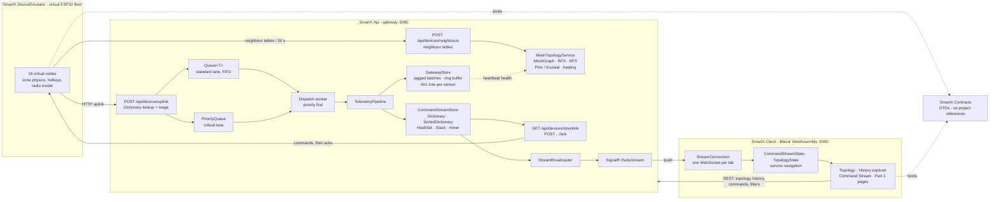

# Smart-X IoT Mesh — Network Topology, Mesh Routing and the Complete Ecosystem

**PROG7312 / AAPD7112 — Portfolio of Evidence, Final Part**
Student number: ST10442063

A **.NET 10** gateway for a distributed IoT mesh, a **Blazor WebAssembly** operator console
and a **virtual ESP32 fleet** that talks to the gateway over HTTP exactly as hardware would.
All three architectural pillars are live:

| Pillar | Built in | What it does |
|---|---|---|
| **Sensor Data Ingestion and Telemetry** | Part 1 | Registration, typed `TelemetryPacket<T>` ingestion, encrypted attachments, the Anomaly Radar |
| **Real-Time Command Stream and History** | Part 2 | `Queue<T>` / `PriorityQueue` triage, `Stack<T>` undo, `Dictionary` / `SortedDictionary` / `HashSet` state, the predictive action engine |
| **Network Topology and Mesh Routing** | **Final PoE** | The mesh as a **graph**, **BFS/DFS** reachability and critical relays, a **minimum spanning tree** (Prim and Kruskal on a hand-written heap) for power-efficient routing, and an **AVL tree** for time-window history queries |

What the final part adds, in one paragraph: every reading is now also kept in a per-sensor
**AVL tree** keyed by timestamp, so "every moisture reading between 14:00 and 16:00 for Node
A" is found by walking down the tree, and its count, minimum, maximum and mean come from
aggregates stored in the tree's nodes. The physical mesh is modelled as a **weighted graph** on
an adjacency list — nodes are vertices on a surveyed site plan, links are edges weighted by
**ETX** (expected transmissions per packet, derived from a radio path-loss model and refined by
the devices' own neighbour reports). **Breadth-first search** finds every node the gateway can
reach and separates *stranded* nodes from *down* ones; **depth-first search** lists the subnet
behind a relay and finds the **articulation points** whose loss would split the mesh; and
**Prim's algorithm** (with **Kruskal's** as an independent cross-check) builds the minimum
spanning tree — the most power-efficient backbone for telemetry to hop home. Fail a node from
the console, or take one down in the emulator, and the tree heals around it.

---

## Contents

- [Quick start](#quick-start)
- [Architecture](#architecture)
- [Using the Network Topology pillar](#using-the-network-topology-pillar) ← the final-PoE walkthrough
- [Where each final-PoE requirement is implemented](#where-each-final-poe-requirement-is-implemented)
- [Final-PoE data structures in depth: trees, graphs and the MST](#final-poe-data-structures-in-depth-trees-graphs-and-the-mst)
- [Part 2: testing the queues, dictionaries and sets](#testing-the-queues-dictionaries-and-sets)
- [Where each Part 2 requirement is implemented](#where-each-part-2-requirement-is-implemented)
- [The Part 2 data structures, and why each one](#the-data-structures-and-why-each-one)
- [The predictive action engine](#the-predictive-action-engine)
- [The device emulator](#the-device-emulator)
- [API reference](#api-reference)
- [Running with Docker](#running-with-docker)
- [Continuous integration](#continuous-integration)
- [Configuration](#configuration)
- [Part 1, carried forward](#part-1-carried-forward)
- [Changes since Part 2](#changes-since-part-2)
- [Changes made to Part 1 code](#changes-made-to-part-1-code)
- [Notes and known limits](#notes-and-known-limits)
- [Repository layout](#repository-layout)
- [Further documents](#further-documents)

---

## Quick start

### Prerequisites

| Requirement | Version | Check with |
|---|---|---|
| .NET SDK | 10.0 | `dotnet --version` |
| Git | any recent | `git --version` |
| Docker *(optional)* | with Compose v2 | `docker compose version` |

Every project targets `net10.0`, set once in `Directory.Build.props`. No workloads are needed.

### Restore, build and test

```bash
git clone https://github.com/EMGPSD/prog7312-group-3-2026-poe-final-st10442063.git
cd prog7312-group-3-2026-poe-final-st10442063
dotnet restore
dotnet build SmartX.sln
dotnet test
```

Expected: a clean build with **zero warnings**, and **382 passing tests**: 352 unit tests over
`SmartX.Core` and 30 end-to-end tests that boot the real gateway in-process (twelve of them
boot the fully seeded site and drive the topology scenarios described below).

### Run the stack

There are three processes: the **gateway API**, the **device emulator** and the **console**.
Pick whichever way suits you.

**Option A — one command (Windows).** Builds, starts the API, waits for its health check, then
opens the emulator and the console in their own windows:

```powershell
.\run-dev.ps1
```

**Option B — one command (macOS / Linux).** Same idea, with logs in `.logs/`:

```bash
./run-dev.sh
```

**Option C — three terminals.** Start them in this order:

```bash
dotnet run --project src/SmartX.Api
```

```bash
dotnet run --project src/SmartX.DeviceEmulator
```

```bash
dotnet run --project src/SmartX.Client
```

**Option D — Docker.** `docker compose up --build` runs all three; see
[Running with Docker](#running-with-docker).

Then open:

| Surface | URL |
|---|---|
| **Network Topology (final PoE)** | <http://localhost:5090/topology> |
| **Telemetry history (AVL tree)** | <http://localhost:5090/topology/history> |
| Command Stream (Part 2) | <http://localhost:5090/stream> |
| Operator console home | <http://localhost:5090> |
| Swagger UI | <http://localhost:5080/swagger> |
| Liveness probe | <http://localhost:5080/api/health> |
| SignalR hub | `ws://localhost:5080/hubs/stream` |

The gateway seeds **17 nodes and 23,040 readings** at startup — a full day of one-a-minute
history for the 14-node Part 1 fleet and the three Part 2 actuators — so any clock window in
the last 24 hours has data to query. Each node is placed on the surveyed site plan and linked
to the nodes it can hear. It also loads **12 labelled demonstration operator sessions** into
the pattern engine. The emulator then publishes for 16 of the 17 nodes every five seconds and
posts every node's neighbour table every 30 seconds. *Irrigation Valve 14* is deliberately
left silent, so there is always a real disconnect to see.

> If you start the console without the emulator, the Command Stream shows a banner saying no
> device has published, with the command to start it. The seeded nodes go Silent after two
> missed heartbeats (about two minutes), which is the disconnect detection doing its job — and
> on the topology page you will see them drop out of the mesh as they do.

---

## Architecture



| Project | Responsibility |
|---|---|
| `SmartX.Core` | Domain model and every data structure the brief marks, across all three parts — including the final PoE's `History/` (AVL tree) and `Mesh/` (graph, traversals, heap, MSTs, route planner). No ASP.NET dependency, so all of it is unit-tested in isolation. |
| `SmartX.Contracts` | The wire contract, with **zero project references**. Neither the console nor the emulator can reach gateway internals; HTTP is the only path. |
| `SmartX.Api` | HTTP surface: ingestion and anomaly detection (Part 1); uplink triage, dispatch, commands, health sweep, predictive engine, SignalR (Part 2); the topology service, site plan, history queries and neighbour reports (final PoE). |
| `SmartX.DeviceEmulator` | The virtual fleet: provisions itself, publishes telemetry, advertises neighbour tables, collects and acknowledges commands. References **only** `SmartX.Contracts`, like real firmware. |
| `SmartX.Client` | Blazor WebAssembly console. |
| `SmartX.Core.Tests` | 352 xUnit tests over the data structures. |
| `SmartX.Api.Tests` | 30 end-to-end tests through `WebApplicationFactory`. |

**One packet's journey.**

1. The emulator posts a frame to `/api/devices/uplink`.
2. Each packet's device is found by MAC in O(1), built into the Part 1 `TelemetryPacket<T>`,
   and triaged against the critical bands.
3. The packet goes into the standard `Queue<T>` or the `PriorityQueue`, and the request
   returns `202` with a receipt naming the lane.
4. The single dispatch worker takes the priority lane first and runs each packet through the
   shared pipeline: Part 1 storage (jagged batch store, ring buffer) **and the sensor's AVL
   tree**, z-score scoring, then the device shadow, timeline, alert set and event log.
5. Critical alerts are pushed to every console immediately; everything else goes out in
   half-second batches.
6. The packet refreshes its node's heartbeat. On the next topology request, a node whose
   heartbeat has lapsed for two windows is down, and every route is recomputed around it.

---

## Using the Network Topology pillar

Open <http://localhost:5090/topology> with the API and emulator running. Seeded addresses used
below:

| Node | MAC | Role on the site plan |
|---|---|---|
| Central Gateway (border-router-01) | `A4:CF:12:FE:00:01` | The root every route leads to |
| Mesh Repeater 08 | `A4:CF:12:00:07:03` | The cheap bridge from Facility A to Facility B |
| Canopy Humidity 02 | `A4:CF:12:00:01:25` | Can just hear Facility B: the weak fallback |
| Pump Feed Meter 04 | `A4:CF:12:00:03:6F` | First hop into Facility B |
| Pump Feed Meter 12 | `A4:CF:12:00:0B:97` | The only relay in range of Valve 06: a **critical relay** |
| Irrigation Valve 06 | `A4:CF:12:00:05:B9` | At the far end of Facility C |
| Irrigation Valve 14 | `A4:CF:12:00:0D:E1` | Never reports: always down |
| Soil Moisture Probe 01 | `A4:CF:12:00:00:00` | Use it for the history walkthrough |

The site plan is laid out on purpose: the link qualities come from the distances, so the layout
*is* the graph, and this one is built to show the two behaviours the brief describes — a mesh
healing around a failed relay, and a single point of failure. Both are pinned down by
end-to-end tests ([`TopologyApiTests`](tests/SmartX.Api.Tests/TopologyApiTests.cs)), so the
walkthrough below cannot quietly stop working.

### 1. Read the map

The tiles across the top come from one snapshot request:

| Tile | Seeded value | Comes from |
|---|---|---|
| Reachable | 17 / 18, 4 hops at most | Breadth-first search from the gateway |
| Down | 1 (Valve 14) | Heartbeat health: silent for two windows |
| Stranded | 0 | BFS: up but never reached |
| Critical relays | 1 (Meter 12) | Tarjan's articulation-point DFS |
| Tree cost | ≈ 16.9 ETX | Sum of the minimum spanning tree's link costs |
| Computed in | a few hundred µs | Both spanning trees, BFS and Tarjan, every request |

On the map, **thick teal lines are the spanning tree** (thicker for stronger links), faint
lines are other live links, dashed red lines touch a down node, and an **amber ring marks a
critical relay**. Hover any node or link for its RSSI, ETX, hop count and tree depth. *All
links* and *Labels* toggle clutter; *Prim* / *Kruskal* switch the algorithm — the total tree
cost is identical, which is the cross-check.

The **Reachability** card lists the BFS rings: every node one hop from the gateway, then two,
and so on, with unreachable nodes at the bottom marked *down* or *stranded*.

### 2. Trace a node's route by MAC

Type `A4:CF:12:00:05:B9` (or just `Valve 06`) into *Trace a node* and press **Trace**, or click
the node. The route animates on the map and the *Route trace* card lists it hop by hop:

```
1  Irrigation Valve 06 → Pump Feed Meter 12     -85 dBm · 1.35 · Σ 1.35
2  Pump Feed Meter 12 → Nutrient EC Probe 11    -79 dBm · 1.02 · Σ 2.37
3  Nutrient EC Probe 11 → Lighting Rail Meter 05 -82 dBm · 1.07 · Σ 3.44
…  … → Central Gateway
```

Each hop shows the link's signal strength, its ETX, and the running total. Below it the card
compares the **fewest-hops route** that BFS found (4 hops for Valve 06) with the tree route
(about 10). That difference is not a bug: see
[Why route on a minimum spanning tree?](#why-route-on-a-minimum-spanning-tree). The page
deep-links, so <http://localhost:5090/topology?mac=A4:CF:12:00:05:B9> opens with the trace
showing, and the selection survives a trip to the Command Stream and back.

Select **Pump Feed Meter 12** and the card warns that it is a critical relay, and lists the
**subnet behind it** — found by depth-first search of the tree — which is just Valve 06.

### 3. Fail the bridge and watch the mesh heal

Select **Mesh Repeater 08** and press **Simulate failure**. This is an operator what-if: the
node goes down immediately, without waiting two heartbeat windows. On the next render:

- the repeater is crossed out and its links turn dashed red;
- the tree now crosses the gap to Facility B on the weak *Canopy Humidity 02 → Pump Feed
  Meter 04* link;
- *Stranded* stays at **0** — every one of the six nodes behind the repeater found another way;
- **Meter 04 becomes a critical relay**, because it is now Facility B's only way in;
- the *Self-healing* card reads:

```
Mesh Repeater 08 · Failed (simulated)
6 nodes routed through it: 6 found another way.
Where traffic hops now
Pump Feed Meter 04 hops via Canopy Humidity 02 instead of Mesh Repeater 08 (+1.89 ETX)
Detours cost +1.89 ETX per round across the mesh.
```

Press **Restore node** and the tree returns to its baseline cost exactly.

### 4. Fail the critical relay and strand a node

Select **Pump Feed Meter 12** and press **Simulate failure**. *Stranded* goes to **1**: Valve 06
is up and still reporting, but nothing in range can carry its packets. Its node is ringed in
dashed red, the *Self-healing* card lists it as stranded **while Pump Feed Meter 12 is down**,
and tracing Valve 06 says *"Stranded … Its route is blocked by Pump Feed Meter 12."* Restore
the meter when you are done.

### 5. A real outage, from the emulator

In the emulator's window press **D** to take Mesh Repeater 08 offline for real. It stops
publishing and stops advertising neighbours. About two minutes later — two missed 60-second
heartbeats — the health sweep marks it Silent, the console toasts *"went offline"*, and the
topology page reloads on that event and shows exactly the healing of step 3, this time
labelled *Silent* rather than *Failed (simulated)*. Press **D** again to bring it back.

### 6. Query history by time window (the AVL tree)

Open **Telemetry history** (or press *Telemetry history* on a selected node), choose
**Soil Moisture Probe 01**, then **Custom** and **14:00 – 16:00**. The page shows:

- **Readings: 120**, with the window's minimum, mean and maximum — read from aggregates stored
  in the tree's nodes. The badge says something like *"Summary: 18 nodes visited of 1,459"*:
  the summary touched about 2 × the tree height, not the 120 readings inside the window.
- A chart of the window in 120 slices, each one O(log n) summary.
- The **log**, grouped by hour, newest first, with each reading's change from the one before.
  *Next* / *Last* jump pages by **rank** in the tree; the pager badge shows the deep page costs
  about the same as the first, against the *"a list scan would read 1,459"* alternative.

The presets (last hour to last 24 hours) are measured back from the newest reading the tree
holds, so a node that has gone quiet still shows its last hours instead of an empty chart.

### 7. The same over HTTP

```bash
# The whole mesh, with either algorithm
curl -s "http://localhost:5080/api/topology?algorithm=Kruskal"

# Route trace and the subnet behind a node
curl -s http://localhost:5080/api/topology/route/A4:CF:12:00:05:B9

# BFS from any node: "what is connected to this subnet?"
curl -s http://localhost:5080/api/topology/nodes/A4:CF:12:00:0B:97/reachability

# Fail and restore a node
curl -s -X POST   http://localhost:5080/api/topology/nodes/A4:CF:12:00:07:03/failure
curl -s -X DELETE http://localhost:5080/api/topology/nodes/A4:CF:12:00:07:03/failure

# 14:00-16:00 today, oldest first (adjust the date), and the same window in 16 chart slices
curl -s "http://localhost:5080/api/history/A4:CF:12:00:00:00?fromUtc=2026-11-13T12:00:00Z&toUtc=2026-11-13T14:00:00Z&order=oldest&pageSize=500"
curl -s "http://localhost:5080/api/history/A4:CF:12:00:00:00/series?fromUtc=2026-11-13T12:00:00Z&toUtc=2026-11-13T14:00:00Z&buckets=16"

# A device advertising its neighbour table
curl -s -X POST http://localhost:5080/api/devices/neighbours -H "Content-Type: application/json" \
  -d '{"reports":[{"macAddress":"A4:CF:12:00:07:03","neighbours":[{"macAddress":"A4:CF:12:00:03:6F","rssiDbm":-80}]}]}'
```

(South Africa is UTC+2, so 14:00–16:00 local is 12:00–14:00 UTC.) Every history response
carries `nodesVisited`, `treeSize` and `treeHeight`; every topology snapshot carries
`computeMicroseconds` and the algorithm's step count.

### 8. The automated proof

```bash
dotnet test --filter "FullyQualifiedName~Mesh|FullyQualifiedName~History|FullyQualifiedName~Topology"
```

runs the final-PoE tests on their own. Highlights:

| Test | Proves |
|---|---|
| `LargeTree_StaysWithinTheAvlHeightBound` | 100,000 random inserts give a tree 17–24 deep (a plain BST could be 100,000) |
| `RandomWindows_MatchALinearScan` | 500 random windows return exactly what a full scan returns |
| `Summarise_VisitsALogarithmicNumberOfNodes` | A 50,000-reading window is summarised in ≤ 3 × height node visits |
| `Page_DeepPage_CostsTheSameAsTheFirst` | Page 1,800 is reached by rank, not by walking pages 1–1,799 |
| `ArticulationPoints_MatchRemovingEachVertexInTurn` | Tarjan agrees with brute force on a 120-node random mesh |
| `SmallGraphs_MatchBruteForceOverEverySpanningTree` | Prim and Kruskal find the true minimum on 60 random graphs |
| `RandomMeshes_PrimAndKruskalAgree` / `LargeMesh_…` | The two algorithms agree on 200 random meshes and a 2,000-node one |
| `FailingTheRepeater_ReroutesFacilityBAtACost` | The step-3 scenario, end to end through HTTP |
| `FailingMeter12_StrandsValve06` | The step-4 scenario |

---

## Where each final-PoE requirement is implemented

| Requirement | Implementation |
|---|---|
| **All three menu options active and interconnected** | [`MainLayout.razor`](src/SmartX.Client/Layout/MainLayout.razor), [`Home.razor`](src/SmartX.Client/Pages/Home.razor); cross-links from [`Sensors/Details.razor`](src/SmartX.Client/Pages/Sensors/Details.razor) |
| **Dashboard view that visualises the mesh** | [`Topology.razor`](src/SmartX.Client/Pages/Topology/Topology.razor), [`MeshGraphView.razor`](src/SmartX.Client/Components/Topology/MeshGraphView.razor) (inline SVG site plan) |
| **Track routing paths by MAC** | Route trace on the topology page; [`MeshRoutePlanner`](src/SmartX.Core/Mesh/MeshRoutePlanner.cs); `GET /api/topology/route/{mac}` |
| **Well-organised historical log of a sensor** | [`Topology/History.razor`](src/SmartX.Client/Pages/Topology/History.razor), [`HistoryRangeChart.razor`](src/SmartX.Client/Components/Topology/HistoryRangeChart.razor), [`HistoryController`](src/SmartX.Api/Controllers/HistoryController.cs) |
| **BST / AVL / Red-Black tree for timestamped telemetry** | [`TelemetryAvlTree`](src/SmartX.Core/History/TelemetryAvlTree.cs), one per sensor in [`SensorHistoryIndex`](src/SmartX.Core/History/SensorHistoryIndex.cs), fed by [`GatewayStore.Accept`](src/SmartX.Api/Services/GatewayStore.cs) |
| **Efficient range queries without iterating a list** | `Range`, `Summarise`, `Rank`/`Select`, `Page`, `Floor`/`Ceiling` in `TelemetryAvlTree`; [`HistoryQueryService`](src/SmartX.Api/Services/History/HistoryQueryService.cs) |
| **Graph: vertices are ESP32 nodes, edges are wireless links** | [`MeshGraph`](src/SmartX.Core/Mesh/MeshGraph.cs), [`MeshVertex` / `MeshLink`](src/SmartX.Core/Mesh/MeshVertex.cs), [`LinkCostModel`](src/SmartX.Core/Mesh/LinkCostModel.cs), built by [`MeshTopologyService`](src/SmartX.Api/Services/Topology/MeshTopologyService.cs) from [`MeshSitePlan`](src/SmartX.Api/Services/Topology/MeshSitePlan.cs) |
| **BFS / DFS: devices connected to a subnet or gateway, which are down, where to hop** | [`MeshTraversal`](src/SmartX.Core/Mesh/MeshTraversal.cs) (`BreadthFirst`, `Downstream`, `ArticulationPoints`, `Components`); the healing report in [`MeshRoutePlanner.Heal`](src/SmartX.Core/Mesh/MeshRoutePlanner.cs) |
| **Prim's or Kruskal's MST for power-efficient routing** | [`PrimMst`](src/SmartX.Core/Mesh/PrimMst.cs) on [`IndexedMinHeap`](src/SmartX.Core/Mesh/IndexedMinHeap.cs); [`KruskalMst`](src/SmartX.Core/Mesh/KruskalMst.cs) on [`DisjointSet`](src/SmartX.Core/Mesh/DisjointSet.cs); [`SpanningTreeResult`](src/SmartX.Core/Mesh/SpanningTreeResult.cs) |
| **Simulated data hits the API like a device** | The emulator's neighbour tables: [`VirtualFleet.NeighbourTables`](src/SmartX.DeviceEmulator/VirtualFleet.cs) → `POST /api/devices/neighbours` |
| **Docker / Docker Compose** | [`docker-compose.yml`](docker-compose.yml) and a Dockerfile per project |
| **CI/CD (a suggested technology, implemented)** | [`.github/workflows/ci.yml`](.github/workflows/ci.yml) |

---

## Final-PoE data structures in depth: trees, graphs and the MST

Every structure below lives in `SmartX.Core`, has no ASP.NET dependency, and is documented in
its source with *why it was chosen*, not just what it does. This section summarises each one's
role in the Network Topology feature and what it buys.

### The AVL tree — `TelemetryAvlTree`

**Role.** One tree per sensor holds every raw reading from the last 48 hours, ordered by
timestamp. It answers the history page's three questions: *which readings fall in this
window?*, *what is the window's count, min, max and mean?*, and *what is on page N of the log?*

**Why a tree, when Part 1 already stores history.** Part 1's jagged `HistoricalBatchStore`
keeps readings in **arrival** order, and arrival order is not time order: a node that loses its
link buffers readings and flushes them late. Finding 14:00–16:00 in it means reading every row.
A sorted list would make every late insert an O(n) shuffle. A binary search tree keeps time
order with O(log n) inserts wherever a reading lands, and a range query descends only into
subtrees that can overlap the window.

**Why AVL rather than red-black.** Both are O(log n). An AVL tree is balanced more strictly —
height ≤ 1.44 log₂ n, against 2 log₂ n for red-black — at the cost of a few more rotations on
insert. The history page reads far more often than any one sensor writes, so the shallower tree
wins. Part 2's `SensorTimeline` uses .NET's `SortedDictionary`, which is a red-black tree, but
it exposes no range query and no way to aggregate a subtree; both are needed here, which is why
this tree is hand-written.

**Augmentation is what makes it fast.** Each node stores the size, sum, minimum and maximum of
its own subtree, recomputed in O(1) on the way back up from every insert and rotation:

```csharp
// TelemetryAvlTree.Node
public void Refresh()
{
    Height  = 1 + Math.Max(Left?.Height ?? 0, Right?.Height ?? 0);
    Size    = 1 + (Left?.Size ?? 0) + (Right?.Size ?? 0);
    Sum     = Value + (Left?.Sum ?? 0d) + (Right?.Sum ?? 0d);
    Minimum = Math.Min(Value, Math.Min(Left?.Minimum ?? double.MaxValue, Right?.Minimum ?? double.MaxValue));
    Maximum = Math.Max(Value, Math.Max(Left?.Maximum ?? double.MinValue, Right?.Maximum ?? double.MinValue));
}
```

So a window summary never visits the readings inside it. It walks down to where the paths to
the window's two ends split, then each side adds *whole subtrees* using their stored aggregate:

```csharp
// Summary of the keys in this subtree at or after `from`: a single root-to-leaf path.
private static RangeSummary SummariseAtOrAfter(Node? node, long from, ref int visited)
{
    if (node is null) return RangeSummary.Empty;
    visited++;

    if (node.Ticks >= from)
    {
        // Everything to the right is at or after this node, so it is all in -
        // the stored aggregate covers it without visiting it.
        var left = SummariseAtOrAfter(node.Left, from, ref visited);
        return RangeSummary.Combine(RangeSummary.Combine(left, node.Self), Aggregate(node.Right));
    }

    return SummariseAtOrAfter(node.Right, from, ref visited);
}
```

Subtree sizes also give **order statistics**: `Rank(t)` counts readings older than `t` in
O(log n), and `Select(i)` finds the i-th reading. The log pager uses them to start any page
directly at its first reading — page 1,800 costs the same as page 1.

| Operation | Cost | Used for |
|---|---|---|
| `Insert` | O(log n), ≤ 2 rotations | Every ingested reading, in any arrival order |
| `TrimBefore` | O(log n) per reading removed | 48-hour retention, from the leftmost node |
| `Range(from, to)` | O(log n + k) | Readings in a window |
| `Summarise(from, to)` | **O(log n)**, independent of k | Window stats; each of the chart's 120 slices |
| `Rank`, `Select`, `CountBetween` | O(log n) | Paging, totals |
| `Page(from, to, skip, take)` | O(log n + take) | The history log |
| `Floor`, `Ceiling` | O(log n) | Nearest reading to a time |

**Recursion.** Insert, delete and the range walks are recursive, because the AVL height bound
keeps recursion shallow — a million readings is about 28 levels. Every invariant (order,
heights, balance in −1..1, every aggregate) is checked by `IsValid`, which the tests call after
inserts and trims so a broken rotation fails where it happens.

**Measured.** In the running system, Soil Moisture Probe 01's tree holds ~1,450 readings at
height 11; the 14:00–16:00 summary visits 18 nodes in about 5 µs.

### The graph — `MeshGraph`

**Role.** The physical mesh: each ESP32 (and the border router) is a vertex; each wireless link
an undirected edge weighted by its **ETX** cost.

**Why an adjacency list.** A mesh is sparse — a node hears the handful of neighbours within
about 70 m, not the whole site — so edges grow with nodes, not nodes squared. An adjacency
matrix would spend V² mostly-empty cells and make "who are my neighbours?" an O(V) row scan.
The adjacency list is a dictionary of dictionaries keyed by the 48-bit `MacKey`:

```csharp
private readonly Dictionary<MacKey, MeshVertex> _vertices = [];
private readonly Dictionary<MacKey, Dictionary<MacKey, MeshLink>> _adjacency = [];
```

The outer lookup finds a node's neighbours in O(1) when a neighbour report arrives; the inner
one finds a specific link in O(1) to update its signal strength. Memory is O(V + E), and
enumerating a node's neighbours — what every traversal and both MST algorithms do on every
step — is O(degree). A failed node is not removed: `LiveNeighbours` simply skips down
vertices, so it drops out of every path while staying on the map.

**Edge weights from radio physics.** [`LinkCostModel`](src/SmartX.Core/Mesh/LinkCostModel.cs)
derives RSSI from distance with the log-distance path-loss model
(−40 dBm at 1 m, exponent 2.7 for a cluttered indoor growing space), turns RSSI into a packet
delivery ratio with a logistic curve, and sets the cost to **ETX = 1 / delivery ratio** — the
expected number of transmissions per delivered packet, the metric Zigbee- and Thread-style
link costs are derived from. Each transmission costs the radio roughly the same energy, so ETX
is proportional to the energy spent moving a packet across the link. No link forms below
−90 dBm (about 71 m), the same floor Part 2's link-loss alert uses.

**Live weights.** Devices advertise neighbour tables (`POST /api/devices/neighbours`), and each
known link's RSSI is smoothed toward the reports with an exponentially weighted moving average
so radio jitter does not flip the tree between near-equal routes. A link never seen before is
only admitted if it is heard 3 dB above the floor — admission hysteresis, found necessary when
noisy reports let edge-of-range pairs gain a link on one lucky reading.

### Breadth-first search — reachability, hops and stranded nodes

`MeshTraversal.BreadthFirst` explores from the gateway in rings with a `Queue<MacKey>`. The
first time BFS reaches a node is by the fewest hops possible, so it yields every node's hop
count, a fewest-hops parent, and the layers drawn in the *Reachability* card, in O(V + E):

```csharp
foreach (var (neighbour, _) in graph.LiveNeighbours(current, isUp))
{
    examined++;
    // Already seen means already reached by a path at least as short.
    if (!hops.TryAdd(neighbour, nextHop)) continue;

    parents[neighbour] = current;
    layers[nextHop].Add(neighbour);
    queue.Enqueue(neighbour);
}
```

Anything **up but never reached** is *stranded*; anything not up is *down*. Telling the two
apart is the point: a down node needs a technician, a stranded node needs a relay. BFS can
start from any node too (`/api/topology/nodes/{mac}/reachability`), answering "what is
connected to this subnet?".

### Depth-first search — the subnet behind a node, and critical relays

`MeshTraversal.Downstream` walks the routing tree depth-first from a node with an explicit
`Stack<T>` and returns every node whose route passes through it — the devices that lose
service if it fails. It is iterative because a routing tree over a long chain of repeaters can
be as deep as the mesh is wide; a test walks a 20,000-hop chain.

`MeshTraversal.ArticulationPoints` is **Tarjan's algorithm**: one DFS numbers vertices in
discovery order and tracks, for each, the lowest number its subtree can reach by a single back
edge. If nothing in a child's subtree can climb above the parent, the parent is the only way
out — an articulation point. One pass, O(V + E), again with an explicit stack of
`(vertex, neighbours, next)` frames. These are the amber-ringed **critical relays**; the
*Single points of failure* note suggests where a second relay would remove the risk. A test
checks Tarjan against the definition by removing every vertex of a random mesh in turn.

### The heap — `IndexedMinHeap<TKey>`

A binary min-heap in an array (children of slot *i* at 2i+1 and 2i+2) plus a dictionary from
each key to its slot. That index is what gives **decrease-key** in O(log n):

```csharp
public bool TryDecrease(TKey key, double priority)
{
    if (!_position.TryGetValue(key, out var slot)) { Push(key, priority); return true; }
    if (priority >= _items[slot].Priority) return false;

    _items[slot] = (key, priority);
    SiftUp(slot);
    return true;
}
```

.NET's `PriorityQueue` cannot find an element to update it, so Prim's algorithm on it has to
enqueue duplicates and skip stale ones, letting the queue grow to O(E). This heap never holds
more than one entry per node. Ties break on the MAC, so the same graph always gives the same
tree.

### Prim's minimum spanning tree — the routing backbone

`PrimMst.Build` grows the tree outward from the gateway: every node outside waits in the heap
at the cost of the cheapest link joining it to the tree; pop the cheapest, add it, and offer
each neighbour the link through it with a decrease-key. The cut property guarantees each
popped link belongs to a minimum spanning tree. With the indexed heap it is O(E log V), and
because it grows from the gateway it only explores the gateway's connected piece and produces
the routing tree **already oriented**: each node's parent is its next hop.

```csharp
while (heap.Count > 0)
{
    var (current, _) = heap.Pop();
    inTree.Add(current);

    if (cheapestLink.TryGetValue(current, out var joinedBy))
        parents[current] = joinedBy.Other(current);

    foreach (var (neighbour, link) in graph.LiveNeighbours(current, isUp))
        if (!inTree.Contains(neighbour) && heap.TryDecrease(neighbour, link.Cost))
            cheapestLink[neighbour] = link;
}
```

### Kruskal's algorithm and union-find — the independent cross-check

`KruskalMst.Build` sorts every live link by cost and keeps each one that joins two pieces not
yet connected. "Already connected?" is answered by a
[`DisjointSet`](src/SmartX.Core/Mesh/DisjointSet.cs) with path halving and union by rank —
effectively O(1) per query — so the sort dominates at O(E log E). Kruskal works on the whole
graph at once, so a partitioned mesh comes out as a forest; the gateway's tree is then oriented
with a BFS. Two independent algorithms agreeing on the total cost is strong evidence both are
right, and the tests check exactly that on hundreds of random meshes. The console's *Prim* /
*Kruskal* switch shows the same total live.

### Why route on a minimum spanning tree?

An MST minimises the **total** cost of connecting every node, not each node's own path. In the
model the brief describes — telemetry hopping through the mesh to the server — each node
forwards one aggregated frame per collection round to its parent (its own reading plus its
children's). Each node then transmits exactly once a round, so the energy of a round is the
sum of every node's uplink ETX: **the tree's total cost, which the MST minimises.** That is the
sense in which it is "the most power-efficient routing".

The trade-off is latency: the MST prefers chains of short, cheap links, so Valve 06 is 10 tree
hops from the gateway where BFS finds 4. The console shows both routes side by side for
exactly this reason. Real protocols such as RPL (used by Thread) route on a shortest-path tree
by ETX instead, which minimises each node's own path cost; that is a recommendation in the
final report, and would slot in beside the MST as a third `SpanningTreeResult` builder.

For the same reason, a reroute's cost is measured by the change in the node's **own uplink**
ETX (its energy per round), not its whole path, which would swing with every rewiring further
up the tree.

### Self-healing — comparing two trees

[`MeshRoutePlanner.Heal`](src/SmartX.Core/Mesh/MeshRoutePlanner.cs) builds two trees on every
request: the **live** tree over nodes that are up, and a **baseline** tree as if every node
that has ever joined the mesh were up. Comparing them yields, for each failure, which nodes
found a new next hop and at what cost, which are stranded and which down nodes block them, and
how many depended on it. Recomputing from scratch on every request is deliberate: all of it is
O(E log V), a warm snapshot takes a few hundred microseconds for this mesh, and there is no
cached tree to fall out of step with a failure.

### Complexity summary

| Structure / algorithm | Time | Space |
|---|---|---|
| AVL insert / trim one | O(log n) | O(n) |
| AVL range | O(log n + k) | O(k) output |
| AVL summary, rank, select | O(log n) | O(1) |
| Graph neighbour lookup / link update | O(1) | O(V + E) |
| BFS reachability | O(V + E) | O(V) |
| DFS downstream | O(subtree) | O(V) |
| Tarjan articulation points | O(V + E) | O(V) |
| Indexed heap push / pop / decrease-key | O(log V) | O(V) |
| Prim with indexed heap | O(E log V) | O(V) |
| Kruskal with union-find | O(E log E) | O(V + E) |
| Healing report | O(E log V) (two trees + BFS) | O(V) |

---

## Testing the queues, dictionaries and sets

*Part 2, unchanged and still fully working in the final application.*

Each section below shows one structure working, using the console, the emulator or plain HTTP.
The HTTP examples are given for bash (`curl`) and PowerShell. Seeded addresses you will use:

| Node | MAC |
|---|---|
| Soil Moisture Probe 01 | `A4:CF:12:00:00:00` |
| Lighting Rail Meter 13 | `A4:CF:12:00:0C:BC` |
| Mesh Repeater 08 | `A4:CF:12:00:07:03` |
| Irrigation Valve 14 *(silent)* | `A4:CF:12:00:0D:E1` |
| Water Pump A | `A4:CF:12:01:00:01` |
| Grow Light Relay | `A4:CF:12:01:00:03` |

### 1. Simulate a high-priority alert (`PriorityQueue`)

You can do this three ways, and all three go through the same uplink and the same triage.
Nothing chooses the lane except the value: a 7% moisture reading is critical because it is
below the 20% floor.

**a) Emulator hotkey.** In the emulator's window press **M** to crash Soil Moisture Probe 01
to 7%, or **S** for a power spike on Lighting Rail Meter 13. The emulator prints the receipt:

```
MOISTURE CRASH on Soil Moisture Probe 01: 7.0% (stays low until a pump or valve in its zone is switched on)
           -> Priority lane, ahead of 0 waiting packets: 7% is below the 20% safety floor
```

**b) Console test tools.** On <http://localhost:5090/stream>, press **Moisture crash**,
**Power spike** or **Link loss** in the *Ingestion queues* card. A red banner pins the alert,
and the *Last critical* tile shows how long it waited.

**c) Plain HTTP**, exactly as a device would post it:

```bash
curl -s -X POST http://localhost:5080/api/devices/uplink \
  -H "Content-Type: application/json" \
  -d '{"gatewayId":"curl","packets":[{"macAddress":"A4:CF:12:00:0C:BC","payloadType":"int","value":"4200"}]}'
```

```powershell
Invoke-RestMethod -Method Post http://localhost:5080/api/devices/uplink -ContentType 'application/json' `
  -Body '{"gatewayId":"ps","packets":[{"macAddress":"A4:CF:12:00:0C:BC","payloadType":"int","value":"4200"}]}'
```

The receipt says which lane the packet took and why:

```json
{ "lane": "Priority", "standardWaiting": 0, "reason": "4200 W is above the 2500 W ceiling", "accepted": true }
```

The triage bands live in `appsettings.json` under `Stream:Bands`:

| Condition | Rule | Severity |
|---|---|---|
| Moisture / environmental % | below 20% | critical |
| Power | above 2,500 W, or above 2.5× the meter's own running baseline | critical |
| Mesh link | below −90 dBm | high |
| Device's own `"alarm": true` flag | any category | high |

Packets are only marked critical if they are, and the alert set dedupes them. For the same
reason, the z-score detector from Part 1 still scores everything afterwards.

### 2. Watch it bypass the FIFO queue (`Queue<T>` + `PriorityQueue`)

The bypass only shows when there is a backlog. The dispatch worker spends a configured 20 ms
per packet, modelling a Raspberry Pi-class gateway (`Stream:SimulatedProcessingMs`), so a flood
takes a while to drain:

1. On the Command Stream page press **Flood 500** (or press **F** in the emulator). The
   standard lane bar fills and starts draining.
2. While it drains, press **Power spike**.
3. The banner reads, for example, *"Taken through the priority lane after 6.2 ms, ahead of 450
   routine packets"*. The **Bypasses** tile goes up by one and **packets overtaken** by 450.

The same over HTTP:

```bash
curl -s -X POST http://localhost:5080/api/stream/test/flood -H "Content-Type: application/json" -d '{"count":500}'
curl -s -X POST http://localhost:5080/api/stream/test/critical -H "Content-Type: application/json" -d '{"kind":"PowerSpike"}'
curl -s http://localhost:5080/api/stream/queue
```

```json
{ "standardDepth": 426, "priorityDepth": 0, "bypasses": 1, "packetsOvertaken": 450,
  "lastPriorityWaitMs": 6.2, "lastPriorityOvertook": 450, "standardMeanWaitMs": 250.7 }
```

Within the priority lane, alerts of equal severity leave in arrival order. That is guaranteed
by the `(severity, sequence)` priority, and proven by
`AlertsOfEqualSeverity_LeaveInArrivalOrder`.

### 3. Undo a command (`Stack<T>`)

1. In the device grid, switch **Water Pump A** on. The switch reads `ON…` with a dashed border
   until the emulator collects the command and acknowledges it, then it settles on `ON`.
   *Command history* shows `#1 Switch ON Water Pump A — Acknowledged` on top.
2. Press **Shut down all valves & pumps**. That is one bulk command over every valve and
   pump, recorded with each target's previous state.
3. Press **Undo**. Only the devices the shutdown actually changed are switched back: a valve
   that was already off stays off, and the never-reporting Irrigation Valve 14 is skipped
   because its earlier state is unknown. The record moves to the redo stack.

Over HTTP:

```bash
curl -s -X POST http://localhost:5080/api/commands -H "Content-Type: application/json" \
  -d '{"action":"SwitchOn","targets":["A4:CF:12:01:00:01"]}'
curl -s -X POST http://localhost:5080/api/commands/undo
curl -s http://localhost:5080/api/commands
```

A command sent to Irrigation Valve 14 is never collected, so it is marked **TimedOut** after
30 seconds. A dead board looks the same way.

### 4. O(1) device lookups (`Dictionary<MacKey, DeviceState>`)

Every uplink response reports how the devices were found and how long each lookup took:

```json
{ "lookupStrategy": "Dictionary<MacKey, DeviceState> - O(1)", "meanLookupNanoseconds": 92.7, "fleetSize": 17 }
```

The emulator prints the same figure on every tick (`lookup 113 ns over 17 devices`).
Register more nodes on the *Register* page and the figure does not grow. Compare the Part 1
*Sensors* page, where a MAC search reports its **binary search** comparisons, which grow
with log₂ n.

The key is a 48-bit `MacKey` struct, not a string. Its hash is provably unique within one
vendor block, so a lookup makes exactly one equality check. The test
`WithinOneVendorBlock_NoTwoDevicesShareAHashCode` checks this over 16,384 addresses.

### 5. Sorted timelines (`SortedDictionary`)

Click any device in the grid: its timeline is drawn from one-minute buckets read in order from
its `SortedDictionary`, with no sorting at render time. To see a late packet slot into place,
publish one stamped ten minutes ago:

```bash
curl -s -X POST http://localhost:5080/api/devices/uplink -H "Content-Type: application/json" \
  -d "{\"packets\":[{\"macAddress\":\"A4:CF:12:00:00:00\",\"payloadType\":\"float\",\"value\":\"30\",\"timestampUtc\":\"$(date -u -d '-10 min' +%Y-%m-%dT%H:%M:%SZ)\"}]}"
curl -s "http://localhost:5080/api/stream/devices/A4:CF:12:00:00:00/timeline?minutes=30"
```

```powershell
$at = (Get-Date).ToUniversalTime().AddMinutes(-10).ToString('o')
Invoke-RestMethod -Method Post http://localhost:5080/api/devices/uplink -ContentType 'application/json' `
  -Body "{`"packets`":[{`"macAddress`":`"A4:CF:12:00:00:00`",`"payloadType`":`"float`",`"value`":`"30`",`"timestampUtc`":`"$at`"}]}"
Invoke-RestMethod "http://localhost:5080/api/stream/devices/A4:CF:12:00:00:00/timeline?minutes=30"
```

`lateArrivals` goes up by one. The bucket ten minutes back now shows a dip to 30%, in its
correct place. The probe's current value is untouched, because a late packet must not rewind
a device.

The event history uses a **reversed** `SortedDictionary` keyed by `(timestamp, sequence)`, so
"the newest 100 events" reads 100 nodes. See <http://localhost:5090/stream/history>.

### 6. Duplicate suppression (`HashSet<T>`)

- **Disconnects.** Irrigation Valve 14 is found silent on every five-second sweep. The history
  has exactly **one** *went offline* entry for it, and the **Duplicates absorbed** tile counts
  every repeat. Press **D** in the emulator to take Mesh Repeater 08 offline: about two minutes
  later it is reported once, however long you leave it. Press **D** again and it is reported
  back online at once.
- **Alerts.** Put the critical packet from section 1 into one frame three times, or post it
  three times within a few seconds (before the emulator's next normal reading clears the
  alert). You get one *Alert raised* entry, and `alertDuplicatesSuppressed` goes up by two.
  Every packet is still processed and stored; only the repeat alert is dropped.

Under the hood, each sweep is reconciled with two set differences,
`newlyDown = silentNow \ knownDown` and `recovered = knownDown \ silentNow`.

### 7. Filtering by category and alert state (set intersection)

On the Command Stream, pick **Actuator** and **Critical**, or call the endpoint:

```bash
curl -s "http://localhost:5080/api/stream/devices?category=Environmental&alert=Critical"
```

The response says how the filter was evaluated, for example
`"strategy": "Environmental set (6) ∩ critical-alert set (1)"`. The intersection walks the
smaller set, so its cost is bounded by that set rather than by the fleet. Filters live in the
address bar (`/stream?category=Actuator&alert=Critical`). They also survive navigating to
another page and back.

### 8. Teach the predictive engine a habit

The seeded history already teaches the brief's own example. When Soil Moisture Probe 01 drops
below 20%, the operator searches "Pump A" and switches it on (4 of 5 past times). To see it:

1. Make sure Water Pump A is **off**. The engine never suggests something already in effect.
2. Press **M** in the emulator, or **Moisture crash** in the console.
3. **Suggested actions** shows *Switch ON Water Pump A*, with the evidence *"…you switched
   Water Pump A on 4 of 6 times (67%), usually within 2 min"*, and the pump's row is flagged.
   The six includes the crash happening now, which you have not answered yet; answering it
   moves the figure to 5 of 6.
4. Press **Run**. The command is issued, lands on the undo stack marked *suggested*, and the
   emulator's moisture probe recovers because its zone is now irrigated.

To teach it something new, use a trigger the seeded history has never seen, so your own
actions are the only evidence:

1. Press **Link loss** in the console's Test tools (Mesh Repeater 08 drops to −94 dBm), then
   switch **Circulation Fan Relay 07** to the opposite of its current state.
2. When the alert clears on the emulator's next normal reading (a few seconds), switch the
   relay back.
3. Do steps 1 and 2 once more.
4. Press **Link loss** a third time. *Switch … Circulation Fan Relay 07* appears under
   Suggested actions. Its reason quotes whichever learned pattern is strongest at that
   moment, which may be your own on/off switching rather than the link loss.

This was verified against a running gateway. A trigger that *does* have seeded history, such
as the power spike, needs more repetitions: its four seeded sessions without the fan count
against the new habit until it holds at least 40% of the time. That dilution is the engine
working as intended.

Everything the engine knows is listed, with confidence, support and lift, at
<http://localhost:5090/stream/history>. A rule stays faded as *learning* until it has been
seen twice and holds at least 40% of the time.

### 9. The automated proof

```bash
dotnet test
```

| Suite | What is proven |
|---|---|
| `DualLaneDispatchQueueTests` | FIFO within the standard lane; a critical item leaves before a 500-item backlog; equal severities stay in arrival order; the overtake count; the standard lane sheds when full but the priority lane never does; 16,000 items from 8 concurrent producers with none lost |
| `CommandHistoryTests` | LIFO undo; redo in reverse; a new command clears redo; a bulk undo restores only what changed and skips unknown states; trimming keeps the newest |
| `MacKeyTests`, `DeviceRegistryTests` | every MAC form gives one key; zero hash collisions in a vendor block; O(1) lookup by MAC and by sensor key; filters by set intersection |
| `SensorTimelineTests`, `StreamEventLogTests` | out-of-order inserts enumerate in time order; eviction past retention; newest-first queries; identical timestamps both kept |
| `ActiveAlertSetTests`, `OutageTrackerTests` | one alert per condition however many repeats; set-difference sweeps report a node once, recover it, and report it again on a new outage |
| `SequentialPatternMinerTests`, `ActionAdvisorTests` | confidence, support, lift and the time window; the brief's "Pump A after Moisture B" habit becomes a suggestion; already-in-effect and dismissed advice is withheld; a falling probe is flagged before it crosses its floor |
| `SmartX.Api.Tests` | the same behaviours end to end over HTTP, with the real background workers |

---

## Where each Part 2 requirement is implemented

| Requirement | Implementation |
|---|---|
| **Navigation** with the three pillars active / upcoming | [`Layout/MainLayout.razor`](src/SmartX.Client/Layout/MainLayout.razor): pillar tabs, per-pillar sub-nav, live link chip, unseen-critical badge; [`Pages/Home.razor`](src/SmartX.Client/Pages/Home.razor) |
| **Asynchronous navigation that keeps state** | [`StreamConnection`](src/SmartX.Client/Services/StreamConnection.cs) (one SignalR link per tab) and [`CommandStreamState`](src/SmartX.Client/Services/CommandStreamState.cs) (the live model, updated even while you are on another page); filters mirrored in the URL |
| **Responsive real-time dashboard** | [`Pages/Stream/CommandStream.razor`](src/SmartX.Client/Pages/Stream/CommandStream.razor), fed by [`StreamBroadcaster`](src/SmartX.Api/Services/Streaming/StreamBroadcaster.cs) over [`StreamHub`](src/SmartX.Api/Hubs/StreamHub.cs) |
| **Manual override commands** (pump, relay) | [`CommandService`](src/SmartX.Api/Services/Streaming/CommandService.cs), [`CommandsController`](src/SmartX.Api/Controllers/CommandsController.cs), [`ActuatorSwitch.razor`](src/SmartX.Client/Components/Stream/ActuatorSwitch.razor) |
| **Search / filter by category or alert state** | [`DeviceRegistry.Query`](src/SmartX.Core/Devices/DeviceRegistry.cs), [`StreamMapper.Filter`](src/SmartX.Api/Services/Streaming/StreamMapper.cs) |
| **Simulated data that hits the API like a device** | [`SmartX.DeviceEmulator`](src/SmartX.DeviceEmulator), [`DevicesController`](src/SmartX.Api/Controllers/DevicesController.cs) |
| **`Queue<T>`** for FIFO telemetry | [`DualLaneDispatchQueue`](src/SmartX.Core/Streaming/DualLaneDispatchQueue.cs) (standard lane), drained by [`TelemetryDispatchWorker`](src/SmartX.Api/Services/Streaming/TelemetryDispatchWorker.cs) |
| **Priority queue** for critical alerts | the same class's `PriorityQueue<T,(int,long)>`; triage in [`CriticalBandClassifier`](src/SmartX.Core/Streaming/CriticalBandClassifier.cs) via [`UplinkService`](src/SmartX.Api/Services/Streaming/UplinkService.cs) |
| **`Stack<T>`** for undo | [`CommandHistory`](src/SmartX.Core/Commands/CommandHistory.cs), [`CommandRecord`](src/SmartX.Core/Commands/CommandRecord.cs) |
| **`Dictionary`** keyed by MAC | [`DeviceRegistry`](src/SmartX.Core/Devices/DeviceRegistry.cs), [`MacKey`](src/SmartX.Core/Devices/MacKey.cs) |
| **`SortedDictionary`** by timestamp for timelines | [`SensorTimeline`](src/SmartX.Core/Timeline/SensorTimeline.cs), [`StreamEventLog`](src/SmartX.Core/Timeline/StreamEventLog.cs), drawn by [`TimelineChart.razor`](src/SmartX.Client/Components/Stream/TimelineChart.razor) |
| **`HashSet<T>`** for unique error / disconnect states | [`ActiveAlertSet`](src/SmartX.Core/Alerts/ActiveAlertSet.cs), [`OutageTracker`](src/SmartX.Core/Alerts/OutageTracker.cs), swept by [`HealthSweepService`](src/SmartX.Api/Services/Streaming/HealthSweepService.cs) |
| **Pattern analysis** of searches and commands | [`SequentialPatternMiner`](src/SmartX.Core/Insights/SequentialPatternMiner.cs), [`ActivityToken`](src/SmartX.Core/Insights/ActivityToken.cs) |
| **Algorithmic suggestions** before the user searches | [`ActionAdvisor`](src/SmartX.Core/Insights/ActionAdvisor.cs), [`TrendForecaster`](src/SmartX.Core/Insights/TrendForecaster.cs), [`TopK`](src/SmartX.Core/Insights/TopK.cs), [`InsightService`](src/SmartX.Api/Services/Streaming/InsightService.cs) |
| **"Suggested Actions" / "Automated Insights" in the UI** | [`SuggestionsPanel.razor`](src/SmartX.Client/Components/Stream/SuggestionsPanel.razor); flagged rows pinned in the grid; learned rules on [`History.razor`](src/SmartX.Client/Pages/Stream/History.razor) |
| Docker | [`docker-compose.yml`](docker-compose.yml) and a Dockerfile per project |

---

## The data structures, and why each one

| Structure | Where | Why this one |
|---|---|---|
| `Queue<T>` | standard lane | Routine telemetry must be processed in arrival order: O(1) enqueue at the tail, O(1) dequeue from the head. |
| `PriorityQueue<T, (int severity, long seq)>` | priority lane | A binary min-heap, O(log n) each way. Plain `PriorityQueue` is **not stable**, so the arrival sequence is part of the priority: equal-severity alerts leave in order, and a spike cannot appear to end before it began. |
| `Stack<CommandRecord>` ×2 | undo / redo | Undo always reverts the most recent command: LIFO. Each record snapshots every target's previous state, so a bulk shutdown reverts exactly in one pop. Trimmed in amortised O(1). |
| `Dictionary<MacKey, DeviceState>` | live registry | Every packet starts with "which device is this?". One integer hash and one equality check, O(1), instead of Part 1's O(log n) string binary search. |
| `Dictionary<SensorCategory, HashSet<MacKey>>` | filter index | A category filter reads one set; combined with an alert state it is a set intersection, O(min(a, b)). |
| `SortedDictionary<DateTimeOffset, TimelineBucket>` | per-device timeline | A red-black tree: a late, out-of-order packet is inserted in its place in O(log n), and the graph enumerates in time order with no sort. Bounded to six hours; the oldest key is the leftmost node. |
| `SortedDictionary<(DateTimeOffset, long), StreamEvent>` reversed + `Queue<key>` | event history | Newest-first so "latest N" touches N nodes; the composite key keeps simultaneous events; the write-order queue makes eviction O(log n). |
| `HashSet<AlertKey>` | active alerts | `Add` returning false *is* the duplicate check, so dedup is free and race-free. |
| `HashSet<MacKey>` + set difference | outages | A node down for an hour is found silent on 700 sweeps and reported on one. |
| `Queue<DeviceCommand>` per device | downlink mailbox | A device must apply its commands in issue order. |
| `HashSet<MacKey>` | non-empty mailboxes | A downlink poll visits only devices with something waiting. |
| `Dictionary<string, Dictionary<string, tally>>` + sliding `Queue` | pattern miner | An adjacency map of a weighted "followed-by" graph over operator events; the window queue evicts old events in arrival order. |
| `PriorityQueue` of size k | `TopK` | Picks the best few suggestions in O(n log k) without sorting everything. |
| `IngestionBuffer<T>` (Part 1) | recent-packet feed | Part 1's ring buffer, reused: the feed only ever wants the newest 200, and it never reallocates. |

---

## The predictive action engine

**What it learns from.** Every alert the gateway raises, every disconnect, and everything the
operator does (searches, opening a device, switching a relay) becomes a short token, e.g.
`alert:CriticalLow:A4:CF:12:00:00:00` or `command:on:A4:CF:12:01:00:01`. A command is recorded
by the state it produced, not the button pressed. "Toggle" means opposite things depending on
the starting state, so it would teach nothing.

**How it learns.** [`SequentialPatternMiner`](src/SmartX.Core/Insights/SequentialPatternMiner.cs)
is windowed sequential association mining. When event B arrives, every distinct event A in
the preceding ten minutes is credited with "was followed by B", once per occurrence of A. From
those counts:

```
confidence(A → B) = times A was followed by B / times A happened
lift(A → B)       = confidence(A → B) / (times B happened / all events)
```

It is incremental: each event costs O(window), and nothing is ever recomputed from scratch.

**How it suggests.** [`ActionAdvisor`](src/SmartX.Core/Insights/ActionAdvisor.cs) treats
three things as triggers:

- every active alert, at full weight;
- every down node, at slightly less;
- the operator's own last few actions, fading with age.

For each trigger it asks the miner what usually follows. The consequent decides the kind of
advice:

- **A command** becomes a one-click *Suggested Action*.
- **A search or an opened device** becomes *"Check this device"*.
- **A further alert** becomes *"Watch this device"*.

Scores are `confidence × trigger weight × support / (support + 2)`. The last factor is a
small-sample penalty, so a habit seen twice is trusted less than one seen ten times. Rules
with lift below 1, meaning things the operator does all the time anyway, are weighted down.
Advice already in effect or dismissed is never shown.

**Before anyone searches.** The advisor also fits a least-squares line through each sensor's
last 30 minutes. A probe falling steadily towards 20% is flagged *before* it crosses
("projected to cross 20% in about 14 min"). If there is a learned response to that probe's
alert, it is offered early. Repeat faults and frequently switched relays are called out too.

**Transparency.** Every suggestion carries its evidence ("4 of 5 times, usually within 2 min")
and a confidence meter with *n*. The History page lists every rule, faded until it is trusted.

---

## The device emulator

```bash
dotnet run --project src/SmartX.DeviceEmulator -- --api http://localhost:5080 --interval 5
```

It asks the gateway for its provisioning manifest (`GET /api/devices/manifest`). Each node
starts from the last value the gateway holds, so the anomaly detector sees no step at handover.
After that it loops:

- **Every tick** it sends one uplink frame for the fleet, as an ESP-NOW or Thread border
  router would.
- **Every second** it polls the downlink for its online nodes, applies each command, and
  acknowledges it.
- **Every sixth tick** (30 s) each online node posts its **neighbour table** to
  `/api/devices/neighbours`: every node it can hear, at the RSSI the path-loss model gives for
  their distance plus about 1.5 dB of Gaussian shadowing. A node taken offline with **D** stops
  reporting and stops being heard, as a dead radio would.

| Key | Effect |
|---|---|
| **S** | Power spike on Lighting Rail Meter 13 for ~30 s. It ends at once if the Grow Light Relay is switched off. |
| **M** | Moisture crash on Soil Moisture Probe 01. It stays low until a pump or valve in its zone is on. |
| **D** | Take Mesh Repeater 08 offline / bring it back. The topology heals around it after two missed heartbeats. |
| **F** | Flood the standard lane with 500 routine packets. |
| **L** | List the fleet. |
| **Q** | Quit. |

| Flag | Default | Effect |
|---|---|---|
| `--api` | `http://localhost:5080` (or `SMARTX_API`) | Gateway address |
| `--interval` | `5` | Seconds between publishes |
| `--no-keys` | off (automatic when input is redirected) | Do not read the keyboard |
| `--incidents <min>` | off | A random spike or crash every *min* minutes (used in Docker) |

---

## API reference

Full interactive documentation at <http://localhost:5080/swagger>.

### Devices (what hardware talks to)

| Method | Path | Purpose |
|---|---|---|
| `POST` | `/api/devices/uplink` | A frame of readings: O(1) lookup, triage, queued · `202` with a receipt per packet |
| `GET` | `/api/devices/manifest` | The fleet provisioned for the emulator |
| `GET` | `/api/devices/downlink?mac=…` | Collect pending commands (marks them delivered) |
| `POST` | `/api/devices/downlink/{commandId}/ack` | Confirm a command was applied |
| `POST` | `/api/devices/neighbours` | A batch of neighbour tables (MAC + RSSI per neighbour) · refines link weights |

### Command stream (what the console talks to)

| Method | Path | Purpose |
|---|---|---|
| `GET` | `/api/stream/snapshot` | Everything for first paint |
| `GET` | `/api/stream/devices?category=&alert=&q=` | Filtered device grid, with the evaluation strategy |
| `GET` | `/api/stream/devices/{mac}/timeline?minutes=` | Per-minute timeline from the sorted dictionary |
| `GET` | `/api/stream/history?take=&kind=&level=&mac=&fromUtc=&toUtc=` | Event history, newest first |
| `GET` | `/api/stream/queue` | Lane depths, bypasses, waits, duplicate counters |
| `POST` | `/api/stream/test/critical` | Inject `PowerSpike`, `MoistureCrash` or `LinkLoss` through the uplink |
| `POST` | `/api/stream/test/flood` | Queue N routine packets |
| `GET` / `POST` | `/api/commands` | Command stacks / issue a command (one or many targets) |
| `POST` | `/api/commands/undo`, `/api/commands/redo` | Pop a stack · `409` when empty |
| `GET` | `/api/insights` | Suggested actions and automated insights |
| `POST` | `/api/insights/activity` | Record a search or an inspected device |
| `POST` | `/api/insights/accept`, `/api/insights/dismiss` | Act on a suggestion |
| `GET` | `/api/insights/patterns` | Every learned rule with support, confidence and lift |

### Topology (final PoE)

| Method | Path | Purpose |
|---|---|---|
| `GET` | `/api/topology?algorithm=Prim\|Kruskal` | The whole mesh: nodes (position, health, hops, next hop, path cost, critical relay), links (RSSI, ETX, in tree), stats and the healing report |
| `GET` | `/api/topology/route/{mac}?algorithm=` | A node's tree route and fewest-hops route, hop by hop, why it is cut off, and its DFS subnet · `404` for an unknown node |
| `GET` | `/api/topology/nodes/{mac}/reachability` | BFS from any node, ring by ring |
| `POST` / `DELETE` | `/api/topology/nodes/{mac}/failure` | Fail / restore a node as an operator what-if · `400` for the gateway |

### History (final PoE)

| Method | Path | Purpose |
|---|---|---|
| `GET` | `/api/history/{mac}?fromUtc=&toUtc=&page=&pageSize=&order=newest\|oldest` | One page of a half-open window `[from, to)`, the window's O(log n) summary, and the cost of each |
| `GET` | `/api/history/{mac}/series?fromUtc=&toUtc=&buckets=` | The window in equal chart slices, each an O(log n) summary |
| `GET` | `/api/history/{mac}/bounds` | Oldest and newest reading, count, tree height, rotations, retention |
| `GET` | `/api/history/{mac}/recent?count=` | The newest readings, newest first |

Omitting `fromUtc`/`toUtc` gives the last two hours of data held. Windows are half-open so
adjacent chart slices never count a reading twice.

### SignalR — `/hubs/stream`

Push only. Commands go through REST, where they are validated.

| Event | When |
|---|---|
| `CriticalAlert` | The moment a new critical condition is processed. Never batched. |
| `PacketsProcessed`, `DevicesChanged`, `EventsLogged` | Every 500 ms, when there is something |
| `QueueStats` | Every 500 ms |
| `CommandsChanged`, `SuggestionsChanged` | When they change, and suggestions every 5 s regardless |

The topology page needs no new hub message: it reloads when a `NodeDown` or `NodeRecovered`
event arrives on `EventsLogged`, and polls every 10 seconds for slower changes such as
neighbour reports shifting link weights.

The Part 1 endpoints (`/api/sensors`, `/api/telemetry`, `/api/sensors/{id}/attachments`,
`/api/deployment`, `/api/dashboard`) are unchanged.

---

## Running with Docker

```bash
docker compose up --build
```

Three containers:

- `api` on `localhost:5080`;
- `emulator`, which waits for the API's health check and reaches it on the compose network;
- `client`, nginx serving the WebAssembly app on `localhost:5090`.

With no keyboard in a container, the emulator schedules a random spike or moisture crash every
three minutes, and the console's Test tools work as usual. Attachments and their encryption key
are in two separate named volumes.

```bash
docker compose down
```

The topology code lives in the existing projects, so the three Dockerfiles needed no change.

---

## Continuous integration

[`.github/workflows/ci.yml`](.github/workflows/ci.yml) runs on every push to `main` and every
pull request:

1. restore, then build in **Release with warnings as errors**;
2. run all 382 tests and upload the TRX results as an artifact;
3. build the three Docker images through `docker compose build`, proving the containers still
   assemble.

---

## Configuration

`src/SmartX.Api/appsettings.json`, section **`Stream`** (Part 2):

| Setting | Default | Effect |
|---|---|---|
| `SimulatedProcessingMs` | `20` | Per-packet processing budget, modelling a constrained gateway so backlogs are visible. `0` = full speed |
| `StandardLaneCapacity` | `10000` | Routine packets held before new ones are shed (alerts never are) |
| `CommandTimeoutSeconds` | `30` | Unacknowledged commands are marked timed out |
| `SweepIntervalSeconds` | `5` | Disconnect and timeout sweep |
| `BroadcastIntervalMs` | `500` | Batch interval for console pushes |
| `EventLogCapacity` | `5000` | History entries kept |
| `UndoDepth` | `100` | How far back undo reaches |
| `PatternWindowMinutes` | `10` | How close events must be to be linked |
| `DismissMinutes` | `30` | How long a dismissed suggestion stays hidden |
| `SeedOperatorHistory` | `true` | Load the 12 demonstration sessions |
| `Bands:*` | see file | Triage thresholds |
| `Advisor:MinSupport` / `MinConfidence` / `MaxSuggestions` | `2` / `0.4` / `6` | When a rule is trusted, and how many suggestions show |

Section **`Gateway`** (Part 1), with the final PoE's changes:

| Setting | Default | Effect |
|---|---|---|
| `SeedReadingsPerSensor` | `1440` *(was 600)* | One reading a minute for 24 hours, so any clock window in the last day has data |
| `HistoryRetentionHours` | `48` | Raw history each sensor's AVL tree keeps behind its newest reading |

`SimulateLiveMesh` and `SimulationIntervalSeconds` are gone since Part 2: live telemetry comes
from the emulator. The topology reuses `Stream:Bands:LinkFloorDbm` (−90 dBm) as the weakest
signal a link can form at.

`src/SmartX.Client/wwwroot/appsettings.json`: `SmartX:ApiBaseUrl`, default
`http://localhost:5080`. The stream hub is derived from it.

---

## Part 1, carried forward

Everything from Part 1 runs unchanged under **Ingestion & Telemetry**: Sensors, Register,
Telemetry, Anomaly Radar and Deployment.

| Part 1 requirement | Implementation |
|---|---|
| **Generics**: `TelemetryPacket<T>` without boxing | [`TelemetryPacket.cs`](src/SmartX.Core/Telemetry/TelemetryPacket.cs). In Part 2 these typed packets are what travel through the queues. |
| **Operator overloading** | [`SensorReading.cs`](src/SmartX.Core/Telemetry/SensorReading.cs): `+ - * / > < >= <= == !=`, unit-aware |
| **Jagged / multi-dimensional arrays** | [`HistoricalBatchStore.cs`](src/SmartX.Core/Storage/HistoricalBatchStore.cs), [`TelemetryHeatMatrix.cs`](src/SmartX.Core/Storage/TelemetryHeatMatrix.cs) |
| **Recursion** | [`RecursiveDeploymentValidator.cs`](src/SmartX.Core/Validation/RecursiveDeploymentValidator.cs), with depth and cycle guards |
| **Custom collection** | [`IngestionBuffer.cs`](src/SmartX.Core/Collections/IngestionBuffer.cs), a ring buffer (reused in Part 2 for the live feed) |
| **Encrypted attachments** | [`AttachmentEncryption.cs`](src/SmartX.Core/Security/AttachmentEncryption.cs): streamed AES-256-GCM in 64 KB chunks, tamper-evident |
| **Engagement feature: Anomaly Radar** | [`DashboardService.cs`](src/SmartX.Api/Services/DashboardService.cs): heartbeat strips scored by rolling z-score, a health ring, an acknowledgement loop |

The Part 1 telemetry workbench publishes synchronously. It now goes through the same
[`TelemetryPipeline`](src/SmartX.Api/Services/TelemetryPipeline.cs) as the dispatch worker, so
a reading published there also reaches the live stream, with its timeline and its alerts.

---

## Changes since Part 2

| Change | Why |
|---|---|
| Every reading also goes into a per-sensor AVL tree inside `GatewayStore.Accept` | One ingestion path feeds all three history structures, whichever route a packet took |
| Seed raised from 600 to 1,440 readings per sensor | Ten hours of history could not answer "14:00–16:00" for most of the day |
| `GatewayStore` exposes `ReadTimeIndex` / `TimeIndexState` | Tree queries run under the store's lock and return snapshots, like every other read |
| The device manifest carries site-plan positions and the gateway's | The emulator needs them to model radio range for its neighbour tables |
| The emulator posts neighbour tables every 30 s | Link weights should come from devices, as the brief asks of all simulated data |
| `GatewayFactory` can boot a seeded gateway | The topology tests check the real site, not a hand-built one |
| Topology pillar enabled in the menu, home page and footer | The final PoE's navigation requirement |
| Healing measured by uplink ETX, against nodes that have joined | Found while checking the seeded site: whole-path deltas and a never-joined node made the report noisy |
| New links need a 3 dB margin to be admitted | Found in the browser: noisy reports let an edge-of-range link appear and hide the critical relay |
| Mesh map moved to full width | Found in the browser: Facility A's labels overlapped in the narrow column |

The last three were found by running the whole stack, not by the tests, and each now has a
test. [`docs/FEEDBACK-LEDGER.md`](docs/FEEDBACK-LEDGER.md) records every change across the
project with its commit.

## Changes made to Part 1 code

| Change | Why |
|---|---|
| `SortedSensorIndex.FindById` is backed by a `Dictionary<Guid, SensorRecord>` | `GatewayStore.Accept` resolves its sensor by id on every packet; that was a linear scan. Now O(1). |
| `GatewayStore.TryRaiseDisconnect` uses a `HashSet<(SensorId, OutageStart)>` | It scanned every anomaly ever raised on each sweep, a cost that grew with uptime. `HashSet.Add` is now both the check and the record. |
| `GatewayStore` raises `SensorRegistered` (outside its lock) | So the live registry stays in step with registrations without the two locks ever being held together. |
| `MeshSimulatorService` removed | The brief requires simulated data to hit the API like a device. The emulator does that over HTTP. |
| Telemetry workbench routed through `TelemetryPipeline` | One ingestion path, so both routes agree about a node. |
| Navigation reorganised by pillar | Part 2's navigation requirement. Every Part 1 page keeps its route. |

---

## Notes and known limits

- **State is in memory.** Restarting the API clears registrations, telemetry, commands and
  learned patterns. The seeded demonstration history reloads each time.
- **The processing budget is a model.** 20 ms per packet stands in for a constrained edge
  gateway, so the bypass can be seen. With `SimulatedProcessingMs: 0` the queues drain
  instantly and the bypass is still correct, just too quick to watch.
- **One dispatch worker, by design.** It keeps each lane's order end to end. A critical packet
  arriving mid-packet waits at most one packet's budget, never for the backlog.
- **Polling downlink.** The emulator polls once a second; a production fleet would use an MQTT
  command topic or LwM2M. The REST shape maps onto either.
- **Single gateway instance.** Both stores are in-process singletons, so the API does not
  scale horizontally as written. Redis or a message broker would be the next step.
- **The site plan is surveyed, not measured.** Positions are hand-placed and link qualities
  start from a path-loss model; neighbour reports then refine them. Real deployments would
  take positions from commissioning and links purely from the radios.
- **Links do not age out.** A link stops being used when either end is down, but a link that
  simply stops being heard between two healthy nodes keeps its last smoothed weight. Production
  stacks expire neighbour entries; that is noted as future work in the final report.
- **The MST is the routing tree.** It minimises total energy under per-round aggregation, at
  the cost of longer paths for some nodes; see
  [Why route on a minimum spanning tree?](#why-route-on-a-minimum-spanning-tree).
- **History retention is 48 hours and in memory**, like everything else; a time-series
  database is the recommended next step.
- **Demonstration history is labelled.** It goes into the pattern model only, never into the
  event log as if it had happened, and one log entry says it was loaded.

---

## Repository layout

```
SmartX.sln
├── Directory.Build.props           shared build settings
├── docker-compose.yml              api + emulator + client
├── run-dev.ps1 / run-dev.sh        one-command launchers
├── .github/workflows/ci.yml        build, test and image build on every push
├── src/
│   ├── SmartX.Core/                domain model and every marked data structure
│   │   ├── History/                TelemetryAvlTree, SensorHistoryIndex     (AVL tree)        final
│   │   ├── Mesh/                   MeshGraph, LinkCostModel                 (graph)           final
│   │   │                           MeshTraversal                            (BFS, DFS, Tarjan)
│   │   │                           IndexedMinHeap, PrimMst                  (heap, Prim)
│   │   │                           DisjointSet, KruskalMst                  (union-find, Kruskal)
│   │   │                           SpanningTreeResult, MeshRoutePlanner     (routes, healing)
│   │   ├── Alerts/                 ActiveAlertSet, OutageTracker            (HashSet)         Part 2
│   │   ├── Commands/               CommandHistory, CommandRecord            (Stack)           Part 2
│   │   ├── Devices/                MacKey, DeviceRegistry, DeviceState      (Dictionary)      Part 2
│   │   ├── Insights/               pattern miner, advisor, forecaster, TopK                   Part 2
│   │   ├── Streaming/              DualLaneDispatchQueue, triage            (Queue, PQ)       Part 2
│   │   ├── Timeline/               SensorTimeline, StreamEventLog           (SortedDictionary) Part 2
│   │   └── Collections, Models, Security, Storage, Telemetry, Validation                      Part 1
│   ├── SmartX.Contracts/           DTOs: Topology, History + Stream, Commands, Insights + Part 1
│   ├── SmartX.Api/
│   │   ├── Controllers/            Topology, History + Devices, Stream, Commands, Insights + Part 1
│   │   ├── Hubs/                   StreamHub (SignalR)
│   │   ├── Services/Topology/      MeshSitePlan, MeshTopologyService
│   │   ├── Services/History/       HistoryQueryService
│   │   └── Services/Streaming/     store, uplink, worker, commands, sweep, insights, broadcaster
│   ├── SmartX.DeviceEmulator/      virtual ESP32 fleet, with neighbour tables
│   └── SmartX.Client/
│       ├── Pages/Topology/         Topology (mesh map, routes, healing), History (AVL explorer)
│       ├── Components/Topology/    MeshGraphView, HistoryRangeChart
│       ├── Pages/Stream/           CommandStream, History
│       ├── Components/Stream/      lanes, switch, timeline, stack, suggestions, feed
│       └── Services/               TopologyState, StreamConnection, CommandStreamState + Part 1
├── tests/
│   ├── SmartX.Core.Tests/          352 unit tests (History/ and Mesh/ for the final PoE)
│   └── SmartX.Api.Tests/           30 end-to-end tests (HistoryApiTests, TopologyApiTests)
├── docs/                           final report draft, feedback ledger
└── demo/                           video scripts and upload samples
```

---

## Further documents

| Document | What it is |
|---|---|
| [`docs/FINAL-REPORT.md`](docs/FINAL-REPORT.md) | Project completion report (challenges, learnings) and technology recommendations — a draft to be finalised and exported to PDF |
| [`docs/FEEDBACK-LEDGER.md`](docs/FEEDBACK-LEDGER.md) | Every update made across Parts 1, 2 and the final PoE, with the reason and the commit |
| [`demo/VIDEO-SCRIPT-FINAL.md`](demo/VIDEO-SCRIPT-FINAL.md) | Walkthrough script for the final demo video |
| [`demo/VIDEO-SCRIPT-PART2.md`](demo/VIDEO-SCRIPT-PART2.md), [`demo/VIDEO-SCRIPT.md`](demo/VIDEO-SCRIPT.md) | The Part 2 and Part 1 scripts |
